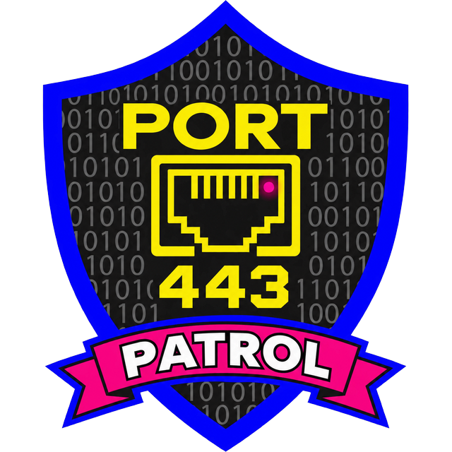

<p align="center">
  <a href="https://port-patrol.pplx.app/"></a>
</p>

# Port Patrol

Built by **Cyber Christy Digital Training** 

A browser game for learning TCP/UDP port numbers for CompTIA Network+, Security+, CCNA, and networking classes.

## Play now

**[Play Port Patrol at port-patrol.pplx.app](https://port-patrol.pplx.app/)**. Nothing to install, and your progress saves automatically in your browser.

Also available on [GitHub Pages](https://cyberchristy919.github.io/port-patrol/).

## Play locally

No install or build step. Either open `index.html` in a browser, or serve the folder:

```bash
git clone <repo-url> port-patrol
cd port-patrol
python3 -m http.server 8000   # then open http://localhost:8000
```

## Game modes

| Mode | What it trains |
| --- | --- |
| Port Quiz | 15 multiple-choice questions, port → service and service → port, with explanations and memory tricks. Press `H` (or Show memory trick) for a hint before answering; hinted answers score 50 and don't add to your streak |
| Packet Rush | Arcade: identify packets before they hit the firewall; speed increases each level |
| Port Blitz | 60-second typed recall of port numbers |
| Patch Panel | Match ports to services across 3 panels, timed |
| Cyber Snake | Classic snake: a protocol name appears, steer into its port number and avoid decoy ports; walls and your tail end the run. Pick Slow (default), Medium, or Fast; with "speed up as the snake grows" on, it gets a little faster with every segment |
| Packet's Port Adventure | A side-scrolling platformer. Packet, a little data packet with suction-cup hands, runs, jumps, and climbs walls through five levels. Each level has locked gates; walk up to the door with the right port number and press Up to open the path. Wrong doors cost a heart. Episode 1 ends with a boss fight against the Man-in-the-Middle |
| Study Deck | Flashcards, searchable reference table, secure/insecure pairs, memory tricks (built-in mnemonics plus your own, with download/load to keep them) |

Every mode ends with a "ports to review" list and a "Drill my misses" button.

## Decks

- **Network+** — the 20 entries in the official N10-009 objective 1.4 list (21 cards, because SIP 5060 and SIPS 5061 are split so the secure version can be drilled on its own)
- **Security+** — commonly tested ports for SY0-701
- **CCNA** — commonly tested ports for 200-301
- **Full deck** — everything (41 entries)

## Add or edit ports

All port data lives in `data.js`. Each entry looks like:

```js
{ id: "https", ports: [443], name: "HTTPS", full: "HTTP Secure", proto: "TCP", exams: "NSC", secure: true, tip: "..." }
```

`exams` uses `N` (Network+), `S` (Security+), and `C` (CCNA).

## Keyboard

- `1`–`4` answer, `Enter` next/start
- Port Blitz: `Enter` submit, `Tab` skip
- Cyber Snake: arrow keys / WASD to steer, `Space` to pause, `1` / `2` / `3` to pick Slow / Medium / Fast on the start or pause screen; swipe or on-screen pad on phones
- Packet's Port Adventure: arrow keys or A / D to move, `Space` (or `Z`) to jump, Up to climb and to go through a door, Down to climb down or drop through a platform, `P` or `Esc` to pause, `1`-`5` to pick an unlocked level; on-screen buttons on phones. Jump into a wall and hold toward it to stick to it
- Flashcards: `Space` flip, arrow keys to move

## Memory tricks

Built-in mnemonics live in `window.MNEMONICS` at the bottom of `data.js`, keyed by port `id`:

```js
smtp: "Send Mail To 25 People.",
```

They appear in Study Deck > Memory tricks, on the back of flashcards, after each quiz answer, and in the review list at the end of a game. Players can write their own trick for any port; it replaces the built-in trick on flashcards and in feedback. Player tricks save automatically with the rest of your progress; **Download my tricks** saves them as a JSON file and **Load tricks file** brings them back.

## Achievements

Open the Trophy Room from the trophy icon in the header or the progress strip on the menu.

- **XP:** 10 per correct answer, 2 per attempt, 25 per finished game, plus 50 / 100 / 200 for bronze, silver, and gold badges.
- **Ranks (9):** Script Kiddie, Packet Sniffer, Port Scanner, Help Desk Hero, Firewall Guardian, SOC Analyst, Threat Hunter, Network Architect, CISO.
- **Badges (28):** grouped by mode (Port Quiz, Packet Rush, Port Blitz, Patch Panel, Cyber Snake, Port Adventure, Study) plus lifetime and mastery goals. Badges are defined in `achievements.js`; each has a `check` function and an optional `progress` function.
- **Port mastery:** a port is mastered after 3 correct answers in a row in any mode. Mastering every port in an exam deck unlocks that deck's Ready badge.
- **Results screen:** shows XP earned, rank ups, new badges, newly mastered ports, and the closest badges to unlock next.

### Saving progress

On the live site (pplx.app, GitHub Pages, or any normal web host), progress and your memory tricks **save automatically** in your browser using small first-party cookies (`pp_p`, `pp_t0`, `pp_t1`). No account is needed, and the game never uploads your progress (browsers do attach these cookies to requests to the game's own host, which ignores them). Saves are capped at about 8 KB; if many long memory tricks don't fit, the Trophy Room says so and the extra tricks stay session-only. **Reset progress** in the Trophy Room (click twice) erases the save.

**Download progress** saves everything to a JSON file and **Load progress** brings it back, which is how to move progress to another device or browser. Loading merges with what's already there and keeps the higher values. In embedded previews that block cookies, the download file is the only way to keep progress.

## Contribute

- [Request a feature](https://github.com/CyberChristy919/port-patrol/issues/new?template=feature_request.yml): new modes, badges, ports, or study tools.
- [Report a bug](https://github.com/CyberChristy919/port-patrol/issues/new?template=bug_report.yml): including any port number or fact that looks wrong.
- [Fork the repo](https://github.com/CyberChristy919/port-patrol/fork) to build your own version, then open a pull request if you'd like to share it back.

The same links are in the footer of the game.

## License

Code is released under the [MIT License](LICENSE). Copyright (c) 2026 Cyber Christy LLC. The Port Patrol and Cyber Christy Digital Training names and logos are not covered by the license; forks should use their own branding.

## Releasing updates

`index.html` loads `styles.css`, `data.js`, `achievements.js`, `app.js`, and `adventure.js` with a `?v=` version tag. Bump that tag whenever those files change (images such as `icon-512.png` and `port-patrol-logo.png` use their own `?v=` tag) so returning players get the new version instead of a cached copy.

## Logo files

- `port-patrol-logo.png`: the full Port Patrol logo (transparent background).
- `icon-512.png`, `favicon.png`, `apple-touch-icon.png`: the simplified shield-and-port icon for small sizes.
- `og-image.png`: the 1200 x 630 preview image shown when the link is shared.
- `logo.png`: the Cyber Christy Digital Training parent logo.
