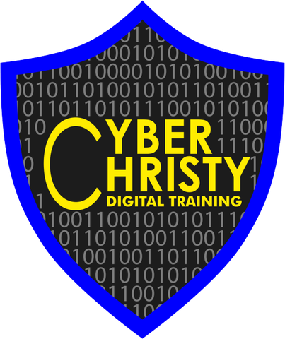

# Port Patrol

Built by **Cyber Christy Digital Training**.



A browser game for learning TCP/UDP port numbers for CompTIA Network+, Security+, CCNA, and networking classes.

## Play locally

No install or build step. Either open `index.html` in a browser, or serve the folder:

```bash
git clone <repo-url> port-patrol
cd port-patrol
python3 -m http.server 8000   # then open http://localhost:8000
```

## Game modes

| Mode | What it trains |
| --- | --- |
| Port Quiz | 15 multiple-choice questions, port → service and service → port, with explanations |
| Packet Rush | Arcade: identify packets before they hit the firewall; speed increases each level |
| Port Blitz | 60-second typed recall of port numbers |
| Patch Panel | Match ports to services across 3 panels, timed |
| Cyber Snake | Classic snake: a protocol name appears, steer into its port number and avoid decoy ports; walls and your tail end the run |
| Study Deck | Flashcards, searchable reference table, secure/insecure pairs, memory tricks (built-in mnemonics plus your own, with download/load to keep them) |

Every mode ends with a "ports to review" list and a "Drill my misses" button.

## Decks

- **Network+** — the 20 entries in the official N10-009 objective 1.4 list (21 cards, because SIP 5060 and SIPS 5061 are split so the secure version can be drilled on its own)
- **Security+** — commonly tested ports for SY0-701
- **CCNA** — commonly tested ports for 200-301
- **Full deck** — everything (41 entries)

## Add or edit ports

All port data lives in `data.js`. Each entry looks like:

```js
{ id: "https", ports: [443], name: "HTTPS", full: "HTTP Secure", proto: "TCP", exams: "NSC", secure: true, tip: "..." }
```

`exams` uses `N` (Network+), `S` (Security+), and `C` (CCNA).

## Keyboard

- `1`–`4` answer, `Enter` next/start
- Port Blitz: `Enter` submit, `Tab` skip
- Cyber Snake: arrow keys / WASD to steer, `Space` to pause; swipe or on-screen pad on phones
- Flashcards: `Space` flip, arrow keys to move

## Memory tricks

Built-in mnemonics live in `window.MNEMONICS` at the bottom of `data.js`, keyed by port `id`:

```js
smtp: "Send Mail To 25 People.",
```

They appear in Study Deck > Memory tricks, on the back of flashcards, after each quiz answer, and in the review list at the end of a game. Players can write their own trick for any port; it replaces the built-in trick on flashcards and in feedback. Player tricks last for the session; **Download my tricks** saves them as a JSON file and **Load tricks file** brings them back.
